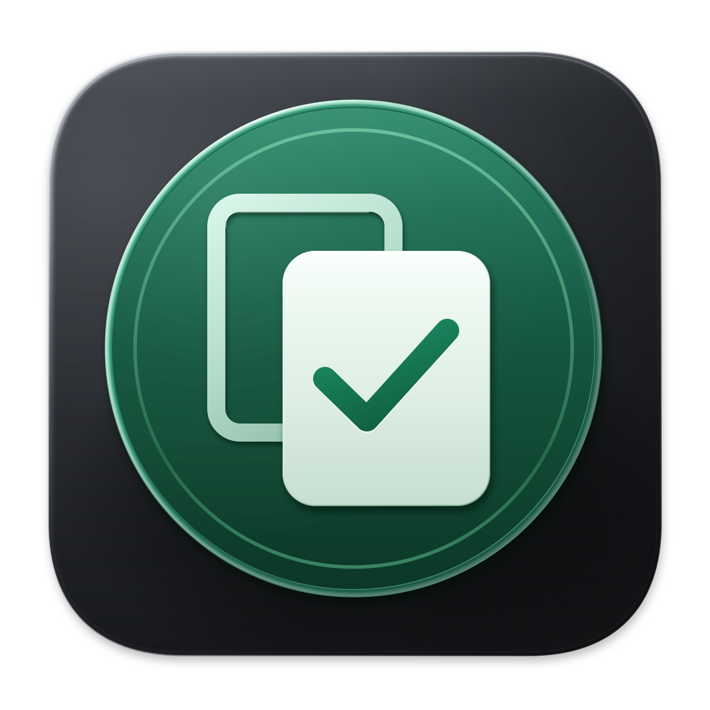
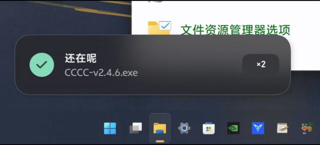
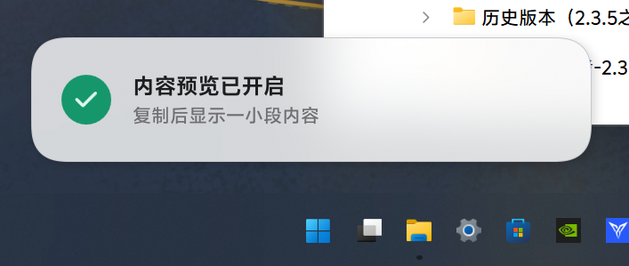
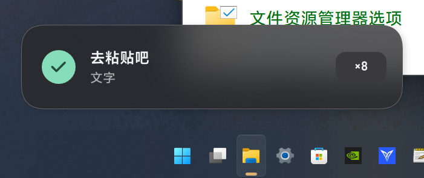

  

# CCCC

一款 Windows 复制反馈工具。

按下 **Ctrl+C** 后，CCCC 会显示提示卡片，帮助你确认复制结果。卡片可以显示内容预览；连续复制时，会显示次数，并通过文字变化和动画提供反馈。

[观看完整演示 · 约 11 秒](docs/media/demo.mp4)

## 复制反馈

首次复制时，卡片淡入。继续复制时，卡片和计数器短暂放大后恢复。停止操作后，卡片自动淡出。

- **内容预览**：显示刚复制的文字或文件信息，可以在托盘菜单中关闭。
- **重复复制计数**：显示连续复制次数，配合不同提示语和弹跳动画。
- **主题适配**：跟随 Windows 浅色或深色模式，支持 Acrylic 材质，也可以切换为不透明背景。
- **托盘设置**：支持暂停提示、显示内容预览、开机自启动和高级材质开关。提示卡片不抢占焦点，也不阻挡鼠标操作。

## 为什么做这个工具

许多应用在执行复制后，没有明显的视觉提示。为了确认复制成功，人们有时会重复按下 Ctrl+C。

CCCC 为这一步补充反馈：显示复制结果，提供简短的内容预览，并记录连续复制次数。它不保存剪贴板历史，也不上传复制内容。

## 外观与日常使用

<table>
  <tr><th>浅色</th><th>深色</th></tr>
  <tr>
    <td></td>
    <td></td>
  </tr>
</table>

CCCC 提供浅色和深色外观，使用连续圆角、Acrylic 背景和淡入淡出动画。文字采用四倍采样绘制，以改善小字号的显示效果。

高级材质可以关闭。系统设置或运行环境不支持材质效果时，程序会使用普通背景，复制提示仍可正常使用。

## 开始使用

可选择 [v2.4.6 稳定版](https://github.com/hakanasora/CCCC/releases/tag/v2.4.6)，或体验 [v2.4.7-preview.1 任务栏预览版](https://github.com/hakanasora/CCCC/releases/tag/v2.4.7-preview.1)。自行构建的方法见[构建指南](docs/building.md)。

预览版可在托盘菜单的“提示样式”中切换普通卡片与任务栏单行提示。任务栏 UI 已确定，空位检测和天气、左侧按钮、自动隐藏、多屏等边缘情况仍在完善，可能出现遮挡或回退到任务栏上方；目前不建议替代稳定版用于长期使用。详见[预览版说明](docs/releases/v2.4.7-preview.1.md)。

构建后运行 `CCCC.exe`，然后照常复制即可。右键托盘图标，可以调整以下选项：

- 暂停提示
- 显示内容预览
- 开机自启动
- 高级材质

预览版额外提供“提示样式”和任务栏“融合任务栏背景”。预览配置独立保存，暂不提供开机自启动；切换到普通卡片后恢复完整内容预览。升级或切换版本前，请先从托盘退出正在运行的 CCCC。

程序适用于 Windows x64，需要 .NET Framework 4.8。构建好的程序可直接运行，无需额外安装字体。

## 项目与许可

项目代码采用 [MIT License](LICENSE)。

卡片文字使用 vivo Sans，计数器使用系统字体 Bahnschrift。vivo Sans 遵循原作者授权，不属于项目的 MIT 许可范围；仓库不包含原始字体文件，构建时需要自行准备。详见[字体与第三方说明](docs/third-party.md)。

[使用方法](docs/usage-v2.4.6.txt)、[构建步骤](docs/building.md)和[当前设计参数](docs/design-v2.4.6.json)见仓库中的相关文档。
